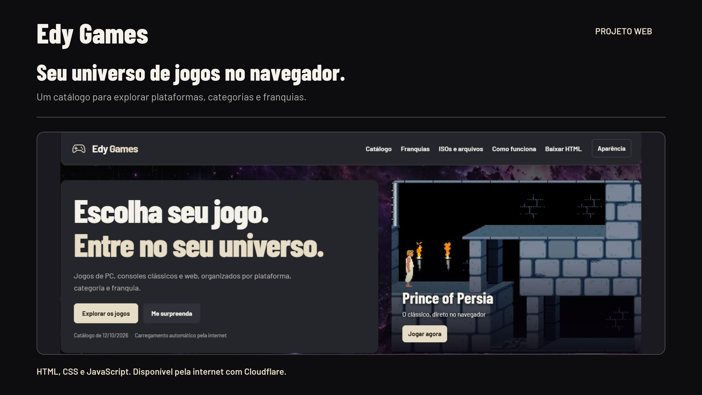
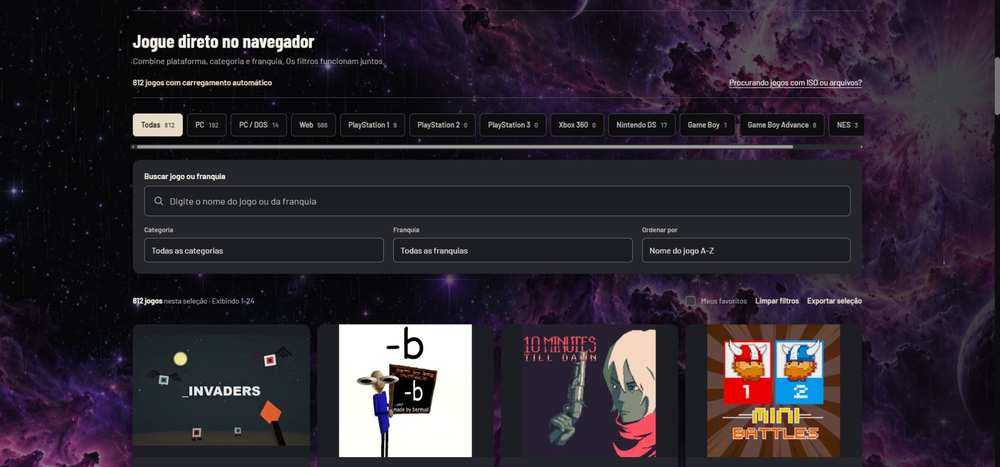
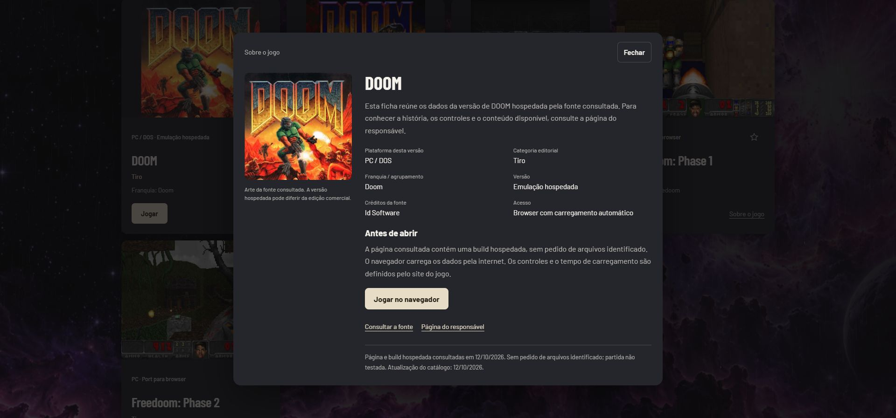
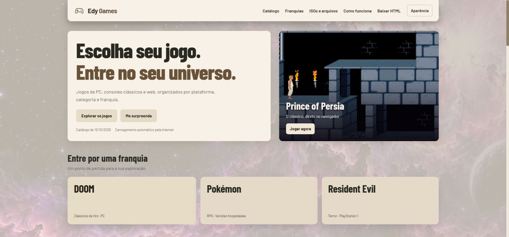

<p align="center">
  
</p>

# Edy Games

Um catálogo para encontrar jogos de navegador sem precisar procurar cada versão em vários sites. Escolha por **plataforma, categoria ou franquia**, consulte a ficha e abra o jogo.

[**Abrir o Edy Games**](https://edy-games.edy-scanurl-family-worker.workers.dev/) · [Demonstração em vídeo](#demonstração) · [Guardar o HTML](outputs/edy-games-catalogo.html)

## Demonstração

https://github.com/user-attachments/assets/9ac29dee-e9ab-4a91-b0c3-410aaec859ab

A demonstração de **1 minuto e 18 segundos** percorre a aplicação real: início com chuva e nebulosa, catálogo, busca, filtros combinados, franquias, ficha do jogo, favoritos, aparência, arquivos próprios, downloads opcionais e perguntas frequentes. [Abrir o MP4 completo](docs/media/demo.mp4).

## O que você encontra

| Recurso | Para que serve |
|---|---|
| **1.894 entradas com arte ou identificação** | Explorar versões hospedadas, jogos web, adaptações, demos e títulos aguardando integração |
| **Coleção WASM Arcade completa** | 1.082 títulos: 55 alternativas compatíveis, GTA V e Minecraft com jogador direto, e 1.025 páginas específicas |
| **Busca e filtros combinados** | Encontrar jogos por nome, plataforma, categoria e franquia |
| **Sobre o jogo** | Consultar versão, créditos, requisitos e fonte de cada entrada |
| **Favoritos** | Guardar uma seleção no próprio navegador |
| **Dois temas e três fundos** | Alternar grafite e bege; escolher nebulosa, fumaça ou areia |
| **Chuva interativa** | Fundo animado com resposta ao mouse e controle de pausa |
| **HTML para guardar** | Usar busca e filtros no arquivo local; abrir jogos com internet |
| **14 fichas de arquivos e downloads** | Consultar projetos com dados próprios e pacotes freeware opcionais |

## Como usar

1. Abra o catálogo e busque um nome ou escolha uma plataforma.
2. Combine categoria e franquia para refinar a seleção.
3. Consulte **Sobre o jogo** para entender a versão disponível.
4. Clique em **Jogar**. Builds compatíveis abrem no player isolado; outros títulos usam o destino externo.
5. Salve favoritos e ajuste a aparência conforme sua preferência.

Selecione **Coleção → WASM Arcade** para consultar os títulos importados. **Somente com acesso direto** mostra os 57 destinos diretos configurados dessa coleção. GTA V abre diretamente `gta.deloskiyt.pl`, e Minecraft abre o jogador EaglercraftX; as 55 alternativas usam o player Edy Games e podem diferir da edição no WASM Arcade. Os outros 1.025 botões **Jogar** abrem a página específica na área do player da origem. Tela cheia nessa página exige uma ação do usuário. [Análise e validação da integração](docs/wasm-arcade-integration.md).

A seção principal prioriza carregamento automático pela internet. **ISOs e arquivos** é uma área separada para projetos que exigem dados do jogador. O Play! de PS2 está nessa seção. Não há emulação nativa de PS3 ou Xbox 360 sem arquivos confirmada neste catálogo.

As URLs foram conferidas em lote em **12/10/2026**. Um endereço acessível não comprova uma partida completa; desempenho, disponibilidade e anúncios nos sites externos podem variar. [Escopo das verificações](docs/TESTING.md).

## Tecnologias e arquitetura

| Tecnologia | Papel no projeto |
|---|---|
| **HTML e CSS** | Estrutura, cartões, layouts responsivos, temas e efeitos visuais |
| **JavaScript e Canvas 2D** | Busca, filtros, favoritos, chuva e interação com o mouse |
| **Node.js** | Montagem do HTML, prévia local e testes de regressão |
| **Cloudflare Workers Static Assets** | Publicação do catálogo em HTTPS |
| **iframe com sandbox** | Isolamento das builds compatíveis do player |

O build gera **um HTML portátil com as capas embutidas** e uma versão para publicação com as novas capas em arquivos WebP locais. O catálogo não exige backend nem chaves de API. Alguns jogos dependem de serviços de terceiros e os jogos com arquivos próprios têm requisitos específicos.

## Executar localmente

Requisito: **Node.js 20 ou superior**. Os comandos ativos usam apenas módulos nativos; não é necessário instalar pacotes.

```sh
git clone https://github.com/EDY075/edy-games.git
cd edy-games
npm run build
npm test
npm run dev
```

Abra **http://127.0.0.1:55075/**. Encerre a prévia com Ctrl+C. Para executar diretamente com Node:

```sh
node scripts/build.mjs
node tests/player.test.mjs
node tests/catalog.test.mjs
node scripts/preview.mjs
```

O build atualiza `outputs/edy-games-catalogo.html`, `publish/index.html` e `publish/covers/`. [Desenvolvimento e publicação](docs/DEVELOPMENT.md).

## Organização do repositório

```text
edy-games/
├── src/          # catálogo e player usados pelo build
├── data/         # catálogo atual, capas e metadados embutidos
├── assets/       # fontes embutidas
├── scripts/      # build e prévia local
├── tests/        # regressões e fixtures específicas
├── publish/      # HTML servido pelo Cloudflare
├── outputs/      # HTML para guardar
└── docs/         # documentação, capa, vídeo e capturas atuais
```

As fontes usadas na aplicação estão separadas dos arquivos gerados. [Mapa dos arquivos](docs/STRUCTURE.md).

## Telas da aplicação

### Catálogo e filtros



### Ficha do jogo



### Tema bege



## Documentação

- [Como desenvolver e publicar](docs/DEVELOPMENT.md)
- [Testes e evidências](docs/TESTING.md)
- [Mapa das fontes](docs/STRUCTURE.md)
- [Segurança e limites](SECURITY.md)

## Fontes e créditos

O Edy Games organiza acesso e informações de projetos como **GN Math, PrinceJS, ScummWEB e ports web independentes**. As fichas apontam as fontes de cada versão. Capas e jogos pertencem aos respectivos titulares; o catálogo não distribui ISOs comerciais nem declara parceria com esses projetos. As fichas mantêm os links consultados e os créditos disponíveis.

Criado por [Edmilson Gomes](https://github.com/EDY075).
